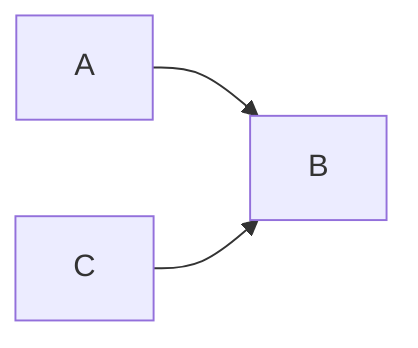
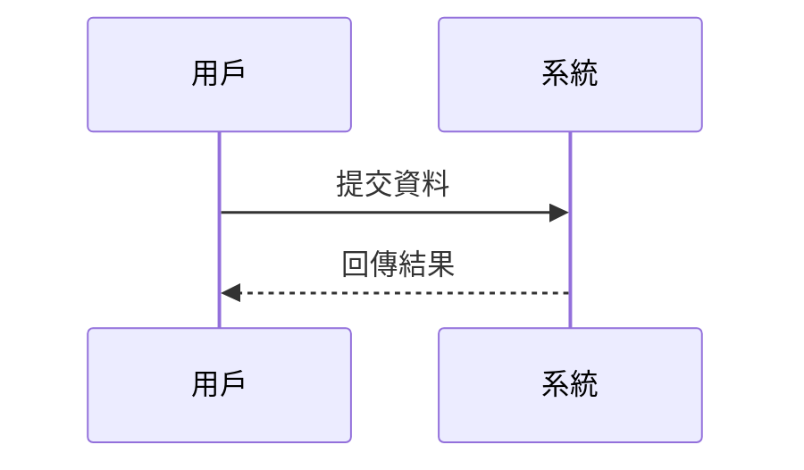
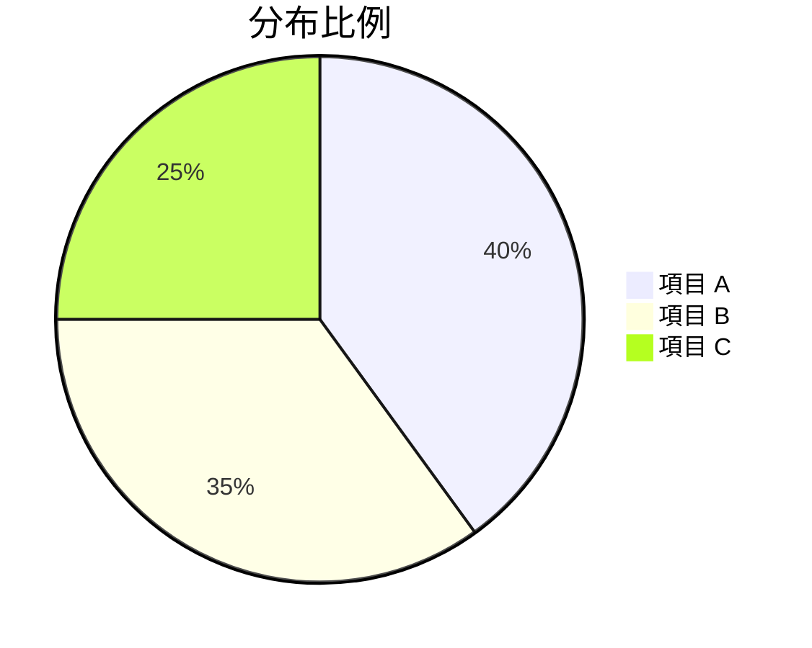
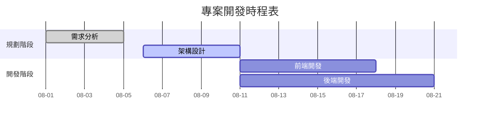
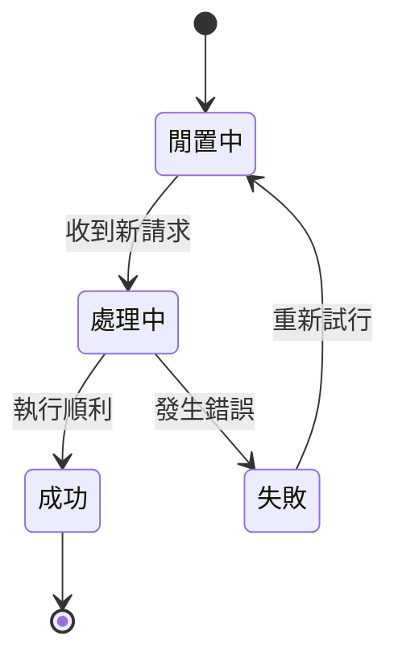
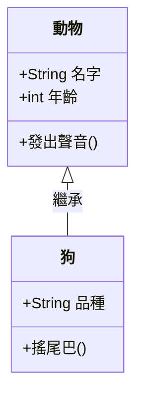
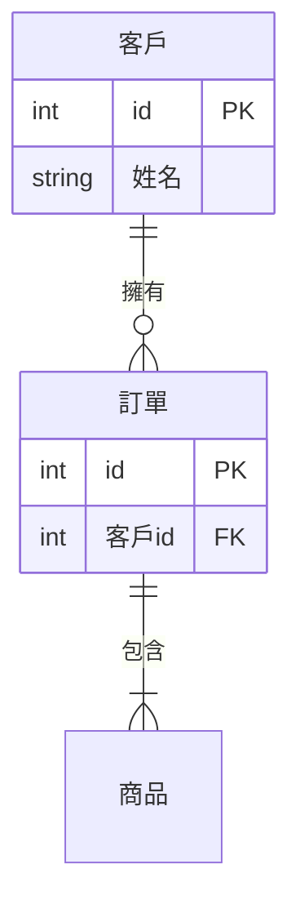
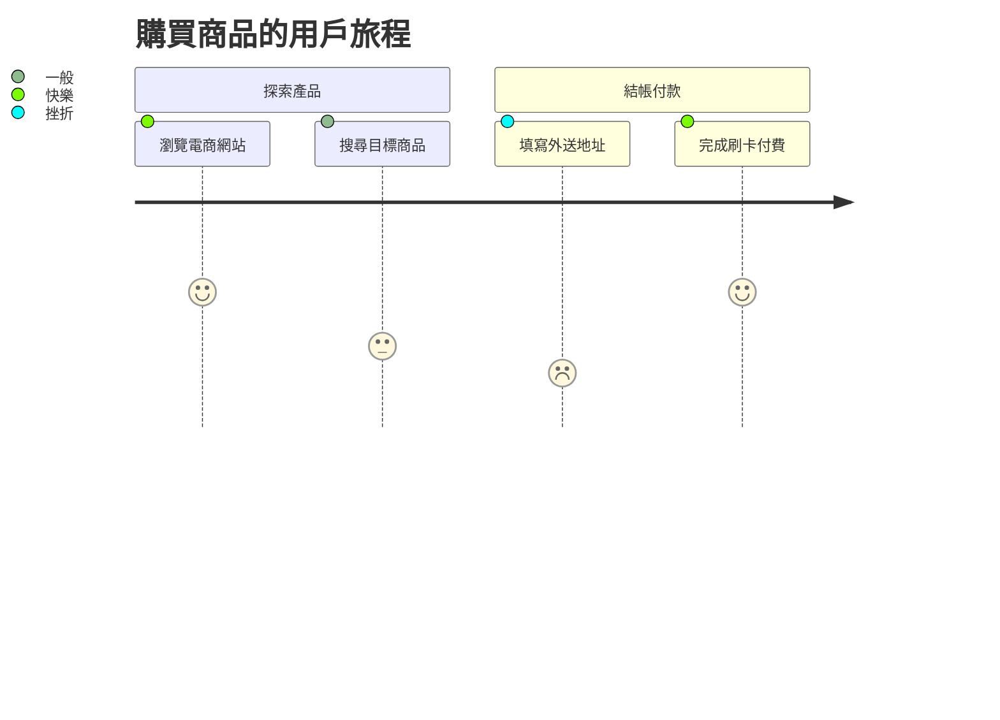
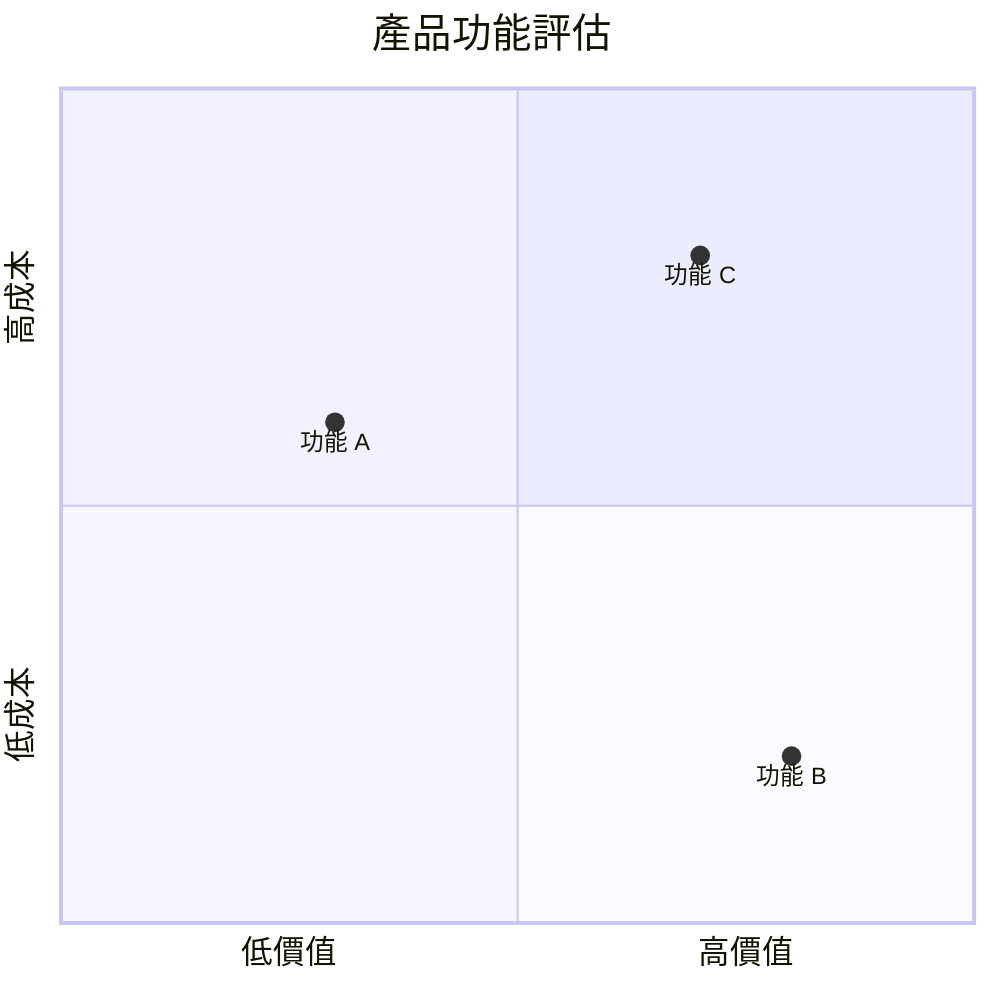
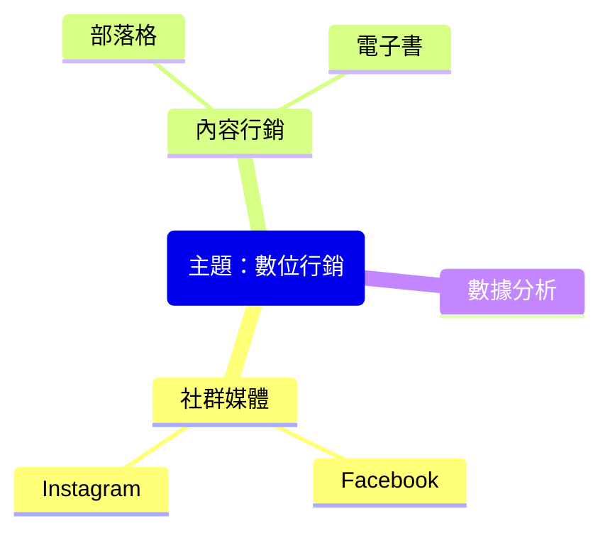

Markdown 常用語法的速查表。每個語法都分成兩塊：上面是原始寫法，下面虛線框裡是實際呈現的樣子。有些語法是 GitHub 等平台的擴充，不是每個地方都能用，會在小節開頭註明。

## 基本語法

### 標題

```text
# 字體H1大小
## 字體H2大小
### 字體H3大小
#### 字體H4大小
##### 字體H5大小
###### 字體H6大小
```

<div class="md-result">
  <p class="md-demo-h1">字體H1大小</p>
  <p class="md-demo-h2">字體H2大小</p>
  <p class="md-demo-h3">字體H3大小</p>
  <p class="md-demo-h4">字體H4大小</p>
  <p class="md-demo-h5">字體H5大小</p>
  <p class="md-demo-h6">字體H6大小</p>
</div>

### 文字樣式

```text
**粗體**

*斜體*

_斜體_

***粗斜體***

~~刪除線~~
```

<div class="md-result" markdown="1">

**粗體**

*斜體*

_斜體_

***粗斜體***

~~刪除線~~

</div>

斜體用 `*` 或 `_` 包起來效果相同。

### 引用

```text
> 這是引用
>
> 引用的第二段
>
>> 巢狀引用
```

<div class="md-result" markdown="1">

> 這是引用
>
> 引用的第二段
>
>> 巢狀引用

</div>

### 清單

```text
- 蘋果
- 香蕉
  - 巢狀項目（縮排 2～4 格）
  - 另一個
- 橘子
```

<div class="md-result" markdown="1">

- 蘋果
- 香蕉
  - 巢狀項目（縮排 2～4 格）
  - 另一個
- 橘子

</div>

### 有序清單

```text
1. 第一步
2. 第二步
3. 第三步
```

<div class="md-result" markdown="1">

1. 第一步
2. 第二步
3. 第三步

</div>

### 分隔線

```text
---

***

___
```

<div class="md-result" markdown="1">

---

***

___

</div>

三種寫法效果相同。

### 連結

```text
[顯示文字](https://example.com)

[帶提示文字](https://example.com "滑鼠移上去會顯示")

<https://example.com>

[跳到本文的標題](#基本語法)

[站內頁面](/blog)
```

<div class="md-result" markdown="1">

[顯示文字](https://example.com)

[帶提示文字](https://example.com "滑鼠移上去會顯示")

<https://example.com>

[跳到本文的標題](#基本語法)

[站內頁面](/blog)

</div>

- `<網址>`：自動連結，直接把網址變成可點的連結
- `#標題`：頁內錨點，跳到同一頁的某個標題
- `/blog`：站內路徑，不用寫完整網址

### 圖片

```text


```

<div class="md-result" markdown="1">


</div>

中括號裡是替代文字，圖片載入失敗或使用螢幕閱讀器時會顯示；網址後面加上引號文字，就是滑鼠移上去時的標題。

### 跳脫字元

```text
\*這不會變斜體\*

\# 這不會變標題

1986\. 這不會變清單
```

<div class="md-result" markdown="1">

\*這不會變斜體\*

\# 這不會變標題

1986\. 這不會變清單

</div>

### 表格

```text
| 欄位   | 型別     | 說明     |
|:-------|:--------:|---------:|
| Id     | int      | 主鍵     |
| Name   | string   | 名稱     |
```

<div class="md-result" markdown="1">

| 欄位   | 型別     | 說明     |
|:-------|:--------:|---------:|
| Id     | int      | 主鍵     |
| Name   | string   | 名稱     |

</div>

第二列的冒號決定對齊方式：

- `:---`：靠左對齊
- `:---:`：置中對齊
- `---:`：靠右對齊

### 任務清單

**GitHub 擴充語法**

```text
- [x] 完成 API 串接
- [ ] 撰寫單元測試
- [ ] 部署
```

<div class="md-result" markdown="1">

- [x] 完成 API 串接
- [ ] 撰寫單元測試
- [ ] 部署

</div>

### 腳註

```text
Blazor 支援 WebAssembly[^1]，也支援伺服器模式[^server]。

[^1]: 需要 .NET 6 以上效能較佳。
[^server]: 透過 SignalR 連線。
```

<div class="md-result" markdown="1">

Blazor 支援 WebAssembly[^1]，也支援伺服器模式[^server]。

[^1]: 需要 .NET 6 以上效能較佳。
[^server]: 透過 SignalR 連線。

</div>

腳註的內容會集中顯示在文章最下方，點上標數字可以跳過去。

### 警示框

**GitHub 專屬**

```text
> [!NOTE]
> 一般補充說明

> [!TIP]
> 小技巧

> [!IMPORTANT]
> 重要資訊

> [!WARNING]
> 需要注意的風險

> [!CAUTION]
> 可能造成不良後果
```

<div class="md-result" markdown="1">

> [!NOTE]
> 一般補充說明

> [!TIP]
> 小技巧

> [!IMPORTANT]
> 重要資訊

> [!WARNING]
> 需要注意的風險

> [!CAUTION]
> 可能造成不良後果

</div>

### 數學公式

**GitHub、Obsidian 支援；一般網站要另外載入 MathJax 或 KaTeX**

```text
行內公式：$E = mc^2$

區塊公式：

$$
\sum_{i=1}^{n} i = \frac{n(n+1)}{2}
$$
```

本站使用的 kramdown 規則不太一樣，行內公式也要寫成 `$$E = mc^2$$`，下面的呈現結果就是用這個寫法產生的。

<div class="md-result" markdown="1">

行內公式：$$E = mc^2$$

區塊公式：

$$
\sum_{i=1}^{n} i = \frac{n(n+1)}{2}
$$

</div>

### 程式碼

````text
```csharp
Model model = new Model();
```
````

<div class="md-result" markdown="1">

```csharp
Model model = new Model();
```

</div>

開頭的 ` ``` ` 後面接語言名稱，就會依該語言上色。要在程式碼區塊裡顯示 ` ``` ` 本身（像上面的原始寫法），外層改用四個反引號包起來。

常用的語言名稱：

#### .NET / 微軟相關

- csharp（或 cs、c#）
- razor、cshtml：Razor Pages / Blazor 元件
- fsharp、vb（VB.NET）
- powershell（或 ps1、pwsh）
- xml：.csproj、web.config 也可以用這個

#### Shell / 命令列

- bash、sh、zsh
- shell、console：適合貼「提示字元 + 輸出」的終端畫面
- bat、cmd：Windows 批次檔

#### Web 前端

- html、css、scss、less
- javascript（js）、typescript（ts）
- jsx、tsx、vue

#### 資料 / 設定檔

- json、jsonc（可加註解的 JSON，例如 appsettings.json）
- yaml（yml）、toml、ini
- csv、sql
- dockerfile、nginx
- graphql、http（HTTP 請求，REST Client 常用）

#### 其他程式語言

- python（py）、java、kotlin、go、rust
- c、cpp（c++）、php、ruby、swift、dart、lua、r

#### 特殊用途

- diff：顯示增刪，+ 開頭變綠、- 開頭變紅，很適合 code review
- mermaid：GitHub、Obsidian 等會直接畫成流程圖、時序圖
- markdown（md）：示範 Markdown 本身
- text、plaintext：不要任何上色
- regex、latex（數學式）

## 圖表

以下都是 Mermaid 語法，在 ` ```mermaid ` 區塊裡描述圖表，GitHub、Obsidian 等平台會直接畫成圖。

### 流程圖

````text

````

<div class="md-result" markdown="1">


</div>

### 時序圖

````text

````

<div class="md-result" markdown="1">


</div>

### 圓餅圖

````text

````

<div class="md-result" markdown="1">


</div>

### 甘特圖

````text

````

<div class="md-result" markdown="1">


</div>

### 狀態圖

````text

````

<div class="md-result" markdown="1">


</div>

### 類別圖

````text

````

<div class="md-result" markdown="1">


</div>

### 實體關係圖

````text

````

<div class="md-result" markdown="1">


</div>

### 使用者旅程圖

````text

````

<div class="md-result" markdown="1">


</div>

### 四象限圖

````text

````

<div class="md-result" markdown="1">


</div>

### 心智圖

````text

````

<div class="md-result" markdown="1">


</div>

### Git 分支圖

````text
```mermaid
gitGraph
    commit
    commit
    branch develop
    checkout develop
    commit
    commit
    checkout main
    merge develop
    commit
```
````

<div class="md-result" markdown="1">

```mermaid
gitGraph
    commit
    commit
    branch develop
    checkout develop
    commit
    commit
    checkout main
    merge develop
    commit
```

</div>
