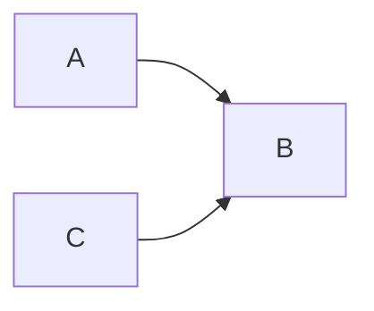
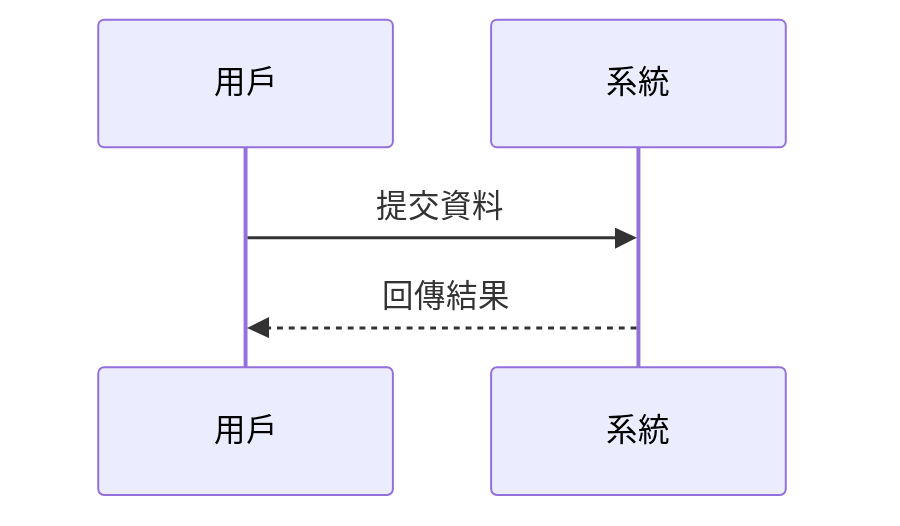
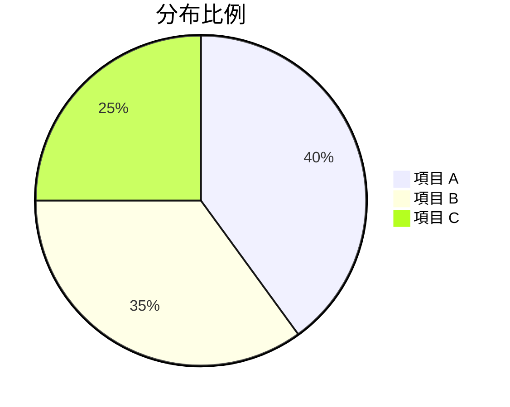
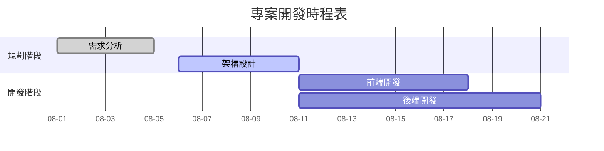
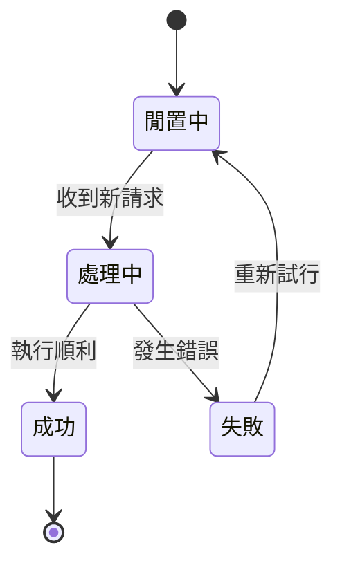
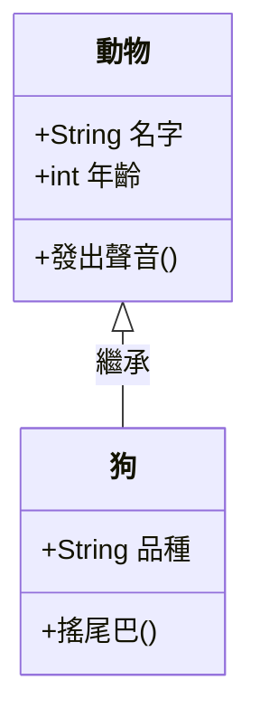
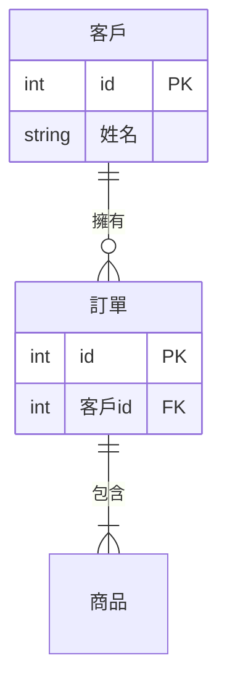
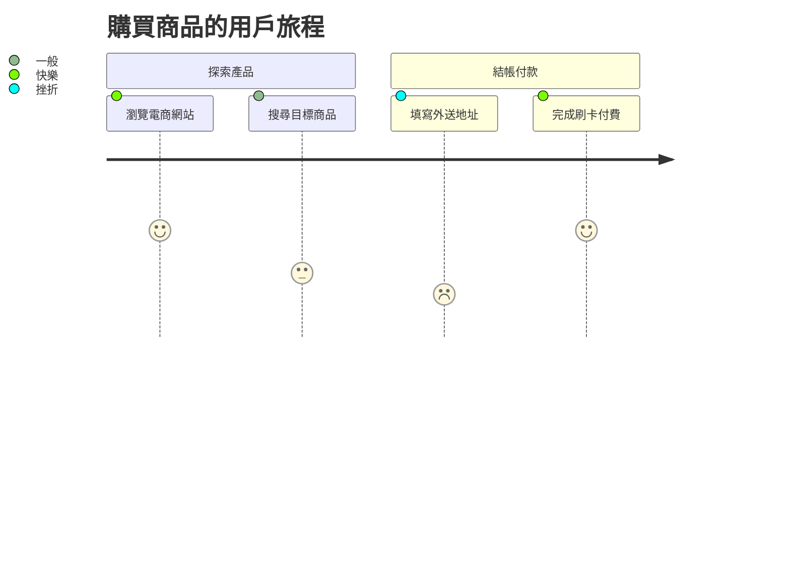
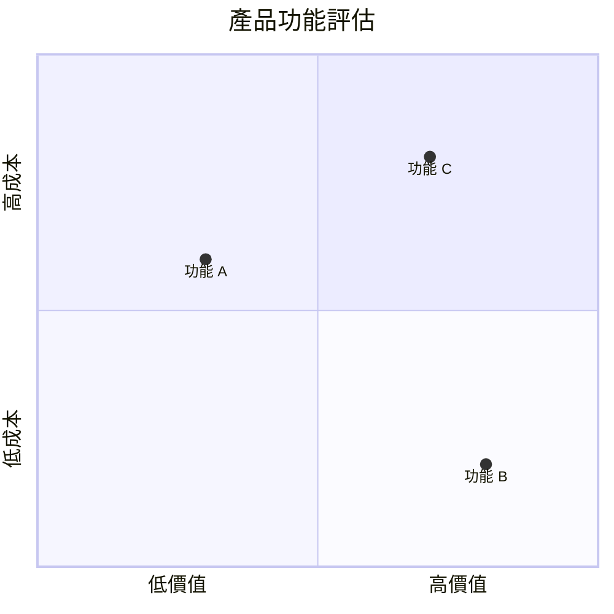
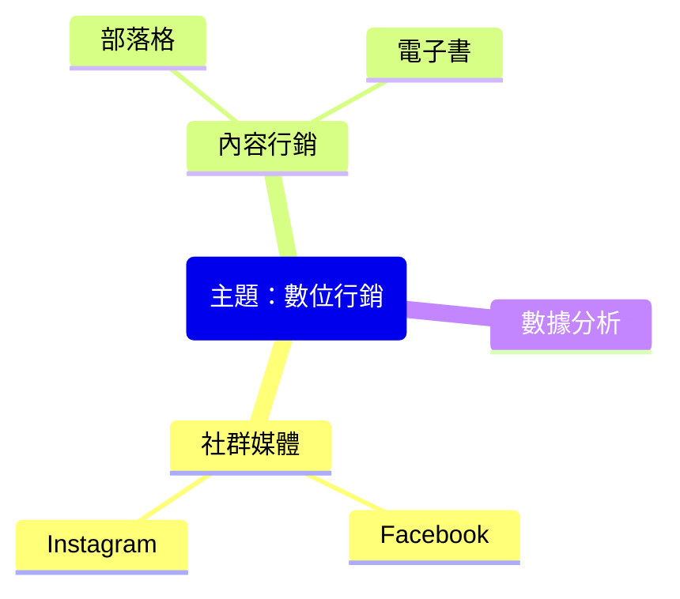

Markdown 常用語法的速查表。每個語法都分成兩塊：上面是原始寫法，下面虛線框裡是實際呈現的樣子。有些語法是 GitHub 等平台的擴充，不是每個地方都能用，會在小節開頭註明。

## 基本語法

### 標題

```text
# 字體H1大小
## 字體H2大小
### 字體H3大小
#### 字體H4大小
##### 字體H5大小
###### 字體H6大小
```

<div class="md-result">
  <p class="md-demo-h1">字體H1大小</p>
  <p class="md-demo-h2">字體H2大小</p>
  <p class="md-demo-h3">字體H3大小</p>
  <p class="md-demo-h4">字體H4大小</p>
  <p class="md-demo-h5">字體H5大小</p>
  <p class="md-demo-h6">字體H6大小</p>
</div>

### 文字樣式

```text
**粗體**

*斜體*

_斜體_

***粗斜體***

~~刪除線~~
```

<div class="md-result" markdown="1">

**粗體**

*斜體*

_斜體_

***粗斜體***

~~刪除線~~

</div>

斜體用 `*` 或 `_` 包起來效果相同。

### 引用

```text
> 這是引用
>
> 引用的第二段
>
>> 巢狀引用
```

<div class="md-result" markdown="1">

> 這是引用
>
> 引用的第二段
>
>> 巢狀引用

</div>

### 清單

```text
- 蘋果
- 香蕉
  - 巢狀項目（縮排 2～4 格）
  - 另一個
- 橘子
```

<div class="md-result" markdown="1">

- 蘋果
- 香蕉
  - 巢狀項目（縮排 2～4 格）
  - 另一個
- 橘子

</div>

### 有序清單

```text
1. 第一步
2. 第二步
3. 第三步
```

<div class="md-result" markdown="1">

1. 第一步
2. 第二步
3. 第三步

</div>

### 分隔線

```text
---

***

___
```

<div class="md-result" markdown="1">

---

***

___

</div>

三種寫法效果相同。

### 連結

```text
[顯示文字](https://example.com)

[帶提示文字](https://example.com "滑鼠移上去會顯示")

<https://example.com>

[跳到本文的標題](#基本語法)

[站內頁面](/blog)
```

<div class="md-result" markdown="1">

[顯示文字](https://example.com)

[帶提示文字](https://example.com "滑鼠移上去會顯示")

<https://example.com>

[跳到本文的標題](#基本語法)

[站內頁面](/blog)

</div>

- `<網址>`：自動連結，直接把網址變成可點的連結
- `#標題`：頁內錨點，跳到同一頁的某個標題
- `/blog`：站內路徑，不用寫完整網址

### 圖片

```text


```

<div class="md-result" markdown="1">


</div>

中括號裡是替代文字，圖片載入失敗或使用螢幕閱讀器時會顯示；網址後面加上引號文字，就是滑鼠移上去時的標題。

### 跳脫字元

```text
\*這不會變斜體\*

\# 這不會變標題

1986\. 這不會變清單
```

<div class="md-result" markdown="1">

\*這不會變斜體\*

\# 這不會變標題

1986\. 這不會變清單

</div>

### 表格

```text
| 欄位 |  型別  | 說明 |
| :--- | :----: | ---: |
| Id   |  int   | 主鍵 |
| Name | string | 名稱 |
```

<div class="md-result" markdown="1">

| 欄位 |  型別  | 說明 |
| :--- | :----: | ---: |
| Id   |  int   | 主鍵 |
| Name | string | 名稱 |

</div>

第二列的冒號決定對齊方式：

- `:---`：靠左對齊
- `:---:`：置中對齊
- `---:`：靠右對齊

### 任務清單

**GitHub 擴充語法**

```text
- [x] 完成 API 串接
- [ ] 撰寫單元測試
- [ ] 部署
```

<div class="md-result" markdown="1">

- [x] 完成 API 串接
- [ ] 撰寫單元測試
- [ ] 部署

</div>

### 腳註

```text
Blazor 支援 WebAssembly[^1]，也支援伺服器模式[^server]。

[^1]: 需要 .NET 6 以上效能較佳。
[^server]: 透過 SignalR 連線。
```

<div class="md-result" markdown="1">

Blazor 支援 WebAssembly[^1]，也支援伺服器模式[^server]。

[^1]: 需要 .NET 6 以上效能較佳。
[^server]: 透過 SignalR 連線。

</div>

腳註的內容會集中顯示在文章最下方，點上標數字可以跳過去。

### 警示框

**GitHub 專屬**

```text
> [!NOTE]
> 一般補充說明

> [!TIP]
> 小技巧

> [!IMPORTANT]
> 重要資訊

> [!WARNING]
> 需要注意的風險

> [!CAUTION]
> 可能造成不良後果
```

<div class="md-result" markdown="1">

> [!NOTE]
> 一般補充說明

> [!TIP]
> 小技巧

> [!IMPORTANT]
> 重要資訊

> [!WARNING]
> 需要注意的風險

> [!CAUTION]
> 可能造成不良後果

</div>

### LaTeX 數學公式

**GitHub、Obsidian 支援；一般網站要另外載入 MathJax 或 KaTeX**

```text
行內公式：$E = mc^2$

區塊公式：

$$
\sum_{i=1}^{n} i = \frac{n(n+1)}{2}
$$
```

本站使用的 kramdown 規則不太一樣，行內公式也要寫成 `$$E = mc^2$$`，下面的呈現結果就是用這個寫法產生的。

<div class="md-result" markdown="1">

行內公式：$$E = mc^2$$

區塊公式：

$$
\sum_{i=1}^{n} i = \frac{n(n+1)}{2}
$$

</div>

#### 一、基礎算術與比較符號

| 說明         | LaTeX 語法        |            顯示效果            |
| :----------- | :---------------- | :----------------------------: |
| 乘號         | `\times`          |           $$\times$$           |
| 除號         | `\div`            |            $$\div$$            |
| 點乘         | `\cdot`           |           $$\cdot$$            |
| 星號（卷積） | `\ast`            |            $$\ast$$            |
| 正負號       | `\pm`             |            $$\pm$$             |
| 負正號       | `\mp`             |            $$\mp$$             |
| 大於等於     | `\geq`            |            $$\geq$$            |
| 小於等於     | `\leq`            |            $$\leq$$            |
| 遠大於       | `\gg`             |            $$\gg$$             |
| 遠小於       | `\ll`             |            $$\ll$$             |
| 不等於       | `\neq`            |            $$\neq$$            |
| 約等於       | `\approx`         |          $$\approx$$           |
| 恆等於       | `\equiv`          |           $$\equiv$$           |
| 相似於       | `\sim`            |            $$\sim$$            |
| 正比於       | `\propto`         |          $$\propto$$           |
| 百分比       | `\%`              |           $$100\%$$            |
| 循環小數     | `0.8\overline{3}` | $$5 \div 6 = 0.8\overline{3}$$ |

---

#### 二、集合與邏輯符號

| 說明                | LaTeX 語法                |          顯示效果          |
| :------------------ | :------------------------ | :------------------------: |
| 屬於 / 不屬於       | `\in` / `\notin`          |      $$\in / \notin$$      |
| 包含（元素）        | `\ni`                     |        $$A \ni x$$         |
| 包含於（子集）      | `\subset` / `\subseteq`   |  $$\subset / \subseteq$$   |
| 方形真子集          | `\sqsubset`               |       $$\sqsubset$$        |
| 方形子集 / 偏序關係 | `\sqsubseteq`             |      $$\sqsubseteq$$       |
| 包含（母集）        | `\supset` / `\supseteq`   |  $$\supset / \supseteq$$   |
| 方形真母集          | `\sqsupset`               |       $$\sqsupset$$        |
| 方形母集或等於      | `\sqsupseteq`             |      $$\sqsupseteq$$       |
| 交集 / 聯集         | `\cap` / `\cup`           |      $$\cap / \cup$$       |
| 方形交集            | `\sqcap`                  |         $$\sqcap$$         |
| 方形聯集            | `\sqcup`                  |         $$\sqcup$$         |
| 空集                | `\emptyset`               |       $$\emptyset$$        |
| 空集（另一種寫法）  | `\varnothing`             |      $$\varnothing$$       |
| 實數集              | `\mathbb{R}`              |       $$\mathbb{R}$$       |
| 整數集              | `\mathbb{Z}`              |       $$\mathbb{Z}$$       |
| 因為 / 所以         | `\because` / `\therefore` | $$\because / \therefore$$  |
| 若且唯若（等價）    | `\iff`                    |          $$\iff$$          |
| 推出（蘊含）        | `\implies`                |        $$\implies$$        |
| 單向右箭頭          | `\Rightarrow`             |      $$\Rightarrow$$       |
| 趨近於              | `\to`                     |          $$\to$$           |
| 映射                | `\mapsto`                 |        $$\mapsto$$         |
| 任意（對所有）      | `\forall`                 |        $$\forall$$         |
| 存在                | `\exists`                 |        $$\exists$$         |
| 與                  | `\land` / `\wedge`        | $$A \land B / A \wedge B$$ |
| 或                  | `\lor` / `\vee`           |  $$C \lor D / C \vee D$$   |
| 非                  | `\lnot` / `\neg`          |    $$\lnot R / \neg R$$    |

---

#### 三、高等數學（微積分、極限、矩陣）

| 說明           | LaTeX 語法                  |                         顯示效果                         |
| :------------- | :-------------------------- | :------------------------------------------------------: |
| 分數           | `\frac{a}{b}`               |                     $$\frac{a}{b}$$                      |
| 繁分數         | `\cfrac{分子}{分母}`        |           $$\cfrac{\frac{1}{2}}{\frac{3}{5}}$$           |
| 平方根         | `\sqrt{x}`                  |                       $$\sqrt{x}$$                       |
| 雙重根式       | `\sqrt{8+2\sqrt{15}}`       |                 $$\sqrt{8+2\sqrt{15}}$$                  |
| n 次方根       | `\sqrt[n]{x}`               |                     $$\sqrt[n]{x}$$                      |
| 加總（級數）   | `\sum_{i=1}^{n}`            |                    $$\sum_{i=1}^{n}$$                    |
| 連乘           | `\prod_{i=1}^{n}`           |                   $$\prod_{i=1}^{n}$$                    |
| 單重積分       | `\int_{a}^{b}`              |                     $$\int_{a}^{b}$$                     |
| 二重積分       | `\iint`                     |                        $$\iint$$                         |
| 三重積分       | `\iiint`                    |                        $$\iiint$$                        |
| 偏微分符號     | `\partial`                  |                       $$\partial$$                       |
| 梯度（倒三角） | `\nabla`                    |                        $$\nabla$$                        |
| 極限           | `\lim_{x \to \infty}`       |                 $$\lim_{x \to \infty}$$                  |
| 無限大         | `\infty`                    |                        $$\infty$$                        |
| 聯立方程式     | `\begin{cases}`（見下方）   | $$\begin{cases} x + y = 10 \\ 2x + 4y = 28 \end{cases}$$ |
| 矩陣           | `\begin{bmatrix}`（見下方） |     $$\begin{bmatrix} a & b \\ c & d \end{bmatrix}$$     |

聯立方程式和矩陣都要寫成多行，以 `\begin{環境名稱}` 開始、`\end{環境名稱}` 結束，中間每一列用 `\\` 換行。

**聯立方程式**用 `cases` 環境，左邊會自動加上大括號：

```text
$$
\begin{cases}
x + y = 10 \\
2x + 4y = 28
\end{cases}
$$
```

<div class="md-result" markdown="1">

$$
\begin{cases}
x + y = 10 \\
2x + 4y = 28
\end{cases}
$$

</div>

**矩陣**同一列的元素用 `&` 隔開。括號樣式由環境名稱決定：`bmatrix` 是中括號、`pmatrix` 是小括號、`vmatrix` 是直線（行列式）、`matrix` 沒有括號。

```text
$$
\begin{bmatrix}
a & b & c \\
d & e & f \\
g & h & i
\end{bmatrix}
$$
```

<div class="md-result" markdown="1">

$$
\begin{bmatrix}
a & b & c \\
d & e & f \\
g & h & i
\end{bmatrix}
$$

</div>

---

#### 四、上標、下標與裝飾符號

| 說明                 | LaTeX 語法            |        顯示效果         |
| :------------------- | :-------------------- | :---------------------: |
| 上標（單字元）       | `x^2`                 |         $$x^2$$         |
| 上標（多字元組合）   | `e^{i\pi}`            |      $$e^{i\pi}$$       |
| 下標（單字元）       | `x_i`                 |         $$x_i$$         |
| 下標（多字元組合）   | `x_{min}`             |       $$x_{min}$$       |
| 同時上下標           | `x_i^2`               |        $$x_i^2$$        |
| 向量箭頭（單字）     | `\vec{a}`             |       $$\vec{a}$$       |
| 向量箭頭（多字）     | `\overrightarrow{AB}` | $$\overrightarrow{AB}$$ |
| 平均值橫線（單字）   | `\bar{x}`             |       $$\bar{x}$$       |
| 平均值橫線（多字）   | `\overline{xyz}`      |   $$\overline{xyz}$$    |
| 估計值（帽子）       | `\hat{y}`             |       $$\hat{y}$$       |
| 一階時間微分（點）   | `\dot{x}`             |       $$\dot{x}$$       |
| 二階時間微分（雙點） | `\ddot{x}`            |      $$\ddot{x}$$       |

---

#### 五、三角函數與幾何

| 說明                 | LaTeX 語法                          |               顯示效果                |
| :------------------- | :---------------------------------- | :-----------------------------------: |
| 正弦                 | `\sin`                              |            $$\sin\theta$$             |
| 餘弦                 | `\cos`                              |            $$\cos\theta$$             |
| 正切                 | `\tan`                              |            $$\tan\theta$$             |
| 餘切                 | `\cot`                              |            $$\cot\theta$$             |
| 正割                 | `\sec`                              |            $$\sec\theta$$             |
| 餘割                 | `\csc`                              |            $$\csc\theta$$             |
| 角                   | `\angle ABC`                        |            $$\angle ABC$$             |
| 三角形符號           | `\triangle ABC`                     |           $$\triangle ABC$$           |
| 全等                 | `\triangle ABC \cong \triangle DEF` | $$\triangle ABC \cong \triangle DEF$$ |
| 相似                 | `\triangle ABC \sim \triangle DEF`  | $$\triangle ABC \sim \triangle DEF$$  |
| 垂直                 | `AB \perp BC`                       |            $$AB \perp BC$$            |
| 平行                 | `AB \parallel CD`                   |          $$AB \parallel CD$$          |
| 度                   | `90^\circ`                          |             $$90^\circ$$              |
| 上畫橫線（線段）     | `\overline{AB}`                     |           $$\overline{AB}$$           |
| 上畫右箭頭（射線）   | `\overrightarrow{CD}`               |        $$\overrightarrow{CD}$$        |
| 上畫左右箭頭（直線） | `\overleftrightarrow{EF}`           |      $$\overleftrightarrow{EF}$$      |
| 上畫弧（弧）         | `\overset{\frown}{PQ}`              |       $$\overset{\frown}{PQ}$$        |

### 程式碼

````text
```csharp
Model model = new Model();
```
````

<div class="md-result" markdown="1">

```csharp
Model model = new Model();
```

</div>

開頭的 ` ``` ` 後面接語言名稱，就會依該語言上色。要在程式碼區塊裡顯示 ` ``` ` 本身（像上面的原始寫法），外層改用四個反引號包起來。

常用的語言名稱：

#### .NET / 微軟相關

- csharp（或 cs、c#）
- razor、cshtml：Razor Pages / Blazor 元件
- fsharp、vb（VB.NET）
- powershell（或 ps1、pwsh）
- xml：.csproj、web.config 也可以用這個

#### Shell / 命令列

- bash、sh、zsh
- shell、console：適合貼「提示字元 + 輸出」的終端畫面
- bat、cmd：Windows 批次檔

#### Web 前端

- html、css、scss、less
- javascript（js）、typescript（ts）
- jsx、tsx、vue

#### 資料 / 設定檔

- json、jsonc（可加註解的 JSON，例如 appsettings.json）
- yaml（yml）、toml、ini
- csv、sql
- dockerfile、nginx
- graphql、http（HTTP 請求，REST Client 常用）

#### 其他程式語言

- python（py）、java、kotlin、go、rust
- c、cpp（c++）、php、ruby、swift、dart、lua、r

#### 特殊用途

- diff：顯示增刪，+ 開頭變綠、- 開頭變紅，很適合 code review
- mermaid：GitHub、Obsidian 等會直接畫成流程圖、時序圖
- markdown（md）：示範 Markdown 本身
- text、plaintext：不要任何上色
- regex、latex（數學式）

## 圖表

以下都是 Mermaid 語法，在 ` ```mermaid ` 區塊裡描述圖表，GitHub、Obsidian 等平台會直接畫成圖。

### 流程圖

````text

````

<div class="md-result" markdown="1">


</div>

### 時序圖

````text

````

<div class="md-result" markdown="1">


</div>

### 圓餅圖

````text

````

<div class="md-result" markdown="1">


</div>

### 甘特圖

````text

````

<div class="md-result" markdown="1">


</div>

### 狀態圖

````text

````

<div class="md-result" markdown="1">


</div>

### 類別圖

````text

````

<div class="md-result" markdown="1">


</div>

### 實體關係圖

````text

````

<div class="md-result" markdown="1">


</div>

### 使用者旅程圖

````text

````

<div class="md-result" markdown="1">


</div>

### 四象限圖

````text

````

<div class="md-result" markdown="1">


</div>

### 心智圖

````text

````

<div class="md-result" markdown="1">


</div>

### Git 分支圖

````text
```mermaid
gitGraph
    commit
    commit
    branch develop
    checkout develop
    commit
    commit
    checkout main
    merge develop
    commit
```
````

<div class="md-result" markdown="1">

```mermaid
gitGraph
    commit
    commit
    branch develop
    checkout develop
    commit
    commit
    checkout main
    merge develop
    commit
```

</div>
